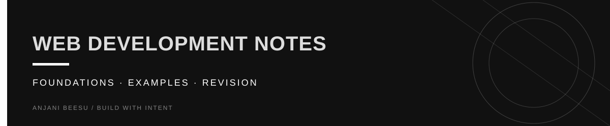

<!-- Visual identity: near-black, warm ivory, and butter yellow. -->

  

<a href="https://github.com/AnjaniBeesu">ANJANI BEESU</a> / <a href="https://www.linkedin.com/in/anjanibeesu/">LINKEDIN</a> / <a href="https://portfolio-theta-olive-54.vercel.app/">PORTFOLIO</a>

---

# HTML Notes

A collection of my HTML notes created while learning web development.

## About

This repository contains organized notes covering HTML fundamentals, concepts, syntax, examples, and practice exercises. It serves as a personal reference for revision and future projects.

## Topics Covered

* HTML Basics
* Document Structure
* Text Formatting
* Links and Images
* Lists
* Tables
* Forms
* Semantic HTML
* Multimedia
* HTML5 Elements
* Best Practices

## Purpose

* Store structured HTML notes
* Track my learning progress
* Revise concepts quickly
* Build a strong foundation for CSS, JavaScript, and full-stack development

## Future Additions

* More detailed notes
* Practice examples
* Mini projects
* Exercises and solutions
